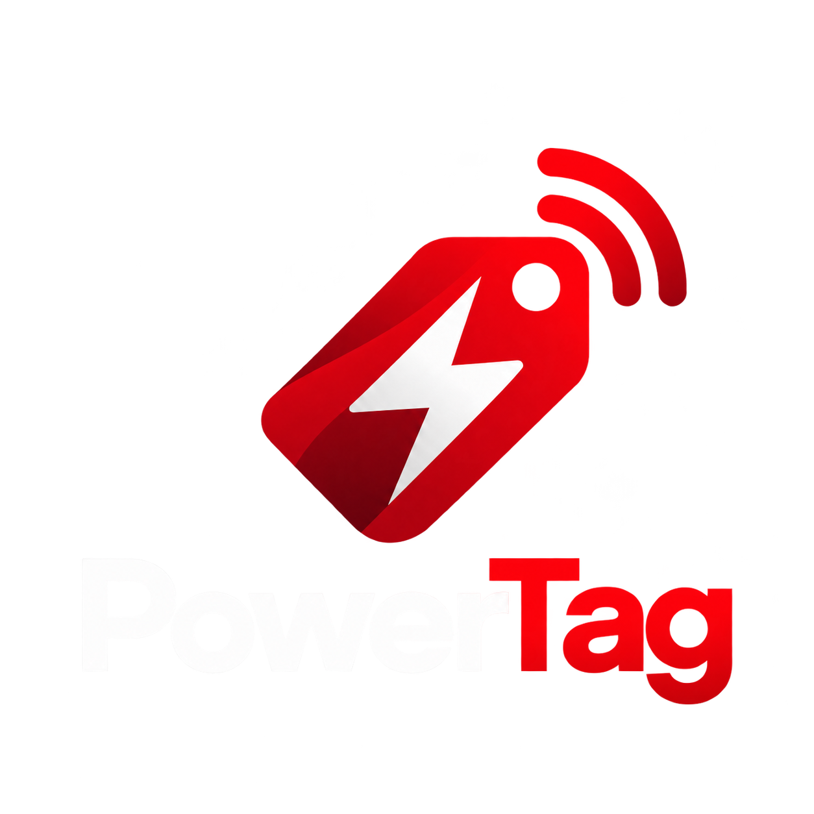
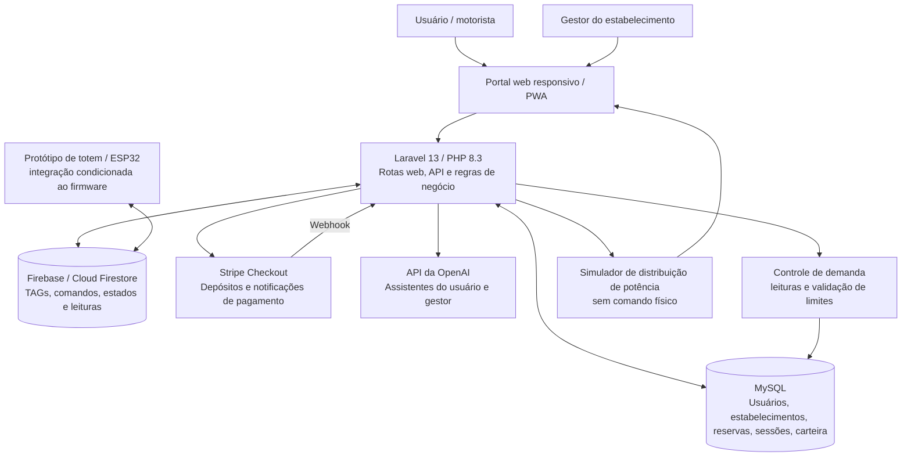
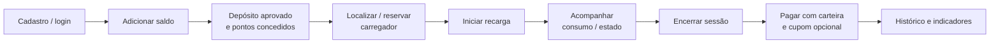

<div align="center">
  <picture>
    <source media="(prefers-color-scheme: dark)" srcset="Logo-PowerTag-Branco.png">
    <source media="(prefers-color-scheme: light)" srcset="Logo-PoerTag-Preto(1).png">
    
  </picture>

  <h1>PowerTag — Gestão Inteligente de Recarga de Veículos Elétricos</h1>

  <strong>Challenge GoodWe 2026 · FIAP · Ciência da Computação · 1CCPX — Equipe 2</strong>
</div>


  # PowerTag — Gestão Inteligente de Recarga de Veículos Elétricos

  **Challenge GoodWe 2026 · FIAP · Ciência da Computação · 1CCPX — Equipe 2**

  **Sprint 4 — Solução Final Integrada e Inovadora**  
  Soluções em Energias Renováveis e Sustentáveis (SERS) · Pensamento Computacional e Automação com Python (PCP)
</div>

---

## 1. Visão geral

A **PowerTag** é uma solução acadêmica de gestão de infraestrutura de recarga de veículos elétricos desenvolvida para o **Challenge GoodWe 2026**, no curso de Ciência da Computação da FIAP. O projeto reúne, em uma plataforma web, funcionalidades voltadas ao **usuário da recarga** e ao **gestor de estabelecimentos**, com integração de dados de recarga, comunicação com totens por Firestore, pagamentos, fidelização, análise operacional e gestão da demanda elétrica.

A proposta é tornar a operação de pontos de recarga mais **organizada, transparente e compatível com os limites da infraestrutura elétrica**. O principal diferencial energético é o módulo que monitora a potência em uso, compara o consumo com os limites cadastrados e **simula a distribuição equilibrada de potência entre os carregadores**.

> **Escopo e transparência:** a aplicação possui funcionalidades implementadas, testes automatizados e fluxos de demonstração. A redistribuição de potência é **calculada e exibida no painel gestor**, mas **não envia comandos físicos para reduzir a potência dos carregadores** nesta versão. Os resultados numéricos apresentados abaixo são **simulações reproduzíveis**, não medições de eficiência energética ou de redução de emissões em uma operação comercial.

### Problema abordado

A expansão da eletromobilidade exige mais do que instalar carregadores. Um operador precisa acompanhar disponibilidade, consumo, usuários e pagamentos, além de evitar que o uso simultâneo dos equipamentos ultrapasse a capacidade elétrica contratada ou instalada. Sem visibilidade, também se torna mais difícil planejar ampliação da infraestrutura e avaliar o aproveitamento dos pontos de recarga.

### Objetivos da solução

- Centralizar cadastro de estabelecimentos, carregadores e usuários.
- Permitir reservas e acompanhamento de sessões de recarga.
- Gerenciar pagamentos por carteira pré-paga e benefícios de fidelidade.
- Integrar comandos e estados de totens ao portal por meio do Firebase/Firestore.
- Monitorar potência ativa (kW) e corrente (A) e identificar capacidade disponível.
- Aplicar verificação do limite elétrico no fluxo de autorização de sessões medidas.
- Simular balanceamento da potência requerida por diferentes carregadores.
- Oferecer indicadores, relatórios e assistência virtual para a operação.

---

## 2. Equipe e identificação acadêmica

| Integrante | RM |
|---|---:|
| Bruno Riquelme Coutinho Pereira | 569619 |
| Eduardo Bigoli Portela | 569897 |
| Gabriel Martins Cordeiro Rodrigues | 570497 |
| Gustavo Fondato de Souza | 573651 |
| Gustavo Martins da Silva | 570584 |
| Lucas Lino Marques da Silva | 572863 |

**Instituição:** FIAP — Faculdade de Informática e Administração Paulista  
**Curso / turma:** Ciência da Computação · 1CCPX · 2º semestre de 2026  
**SERS:** Prof. André Tritiack de Farias  
**PCP:** Prof. Alexandre Russi Junior  
**Aplicação Web:** https://goodwe-1lzr.onrender.com
**Repositório:** https://github.com/C0utinhoxx/goodwe

---

## 3. Funcionalidades da solução final

### 3.1. Portal do usuário

- Cadastro, autenticação e gerenciamento de perfil e veículos.
- Visualização de carregadores, status e informações da rede.
- Reserva de carregadores disponíveis, com tolerância de chegada e regras de expiração.
- Carteira com saldo, depósitos e histórico de movimentações.
- Recarga com acompanhamento de sessão, energia medida e cobrança vinculada à tarifa.
- Programa de pontos, resgate de cupons e desconto no pagamento de recargas.
- Interface para interação com totens configurados no Firestore, incluindo início, PIN e parada.
- Assistente virtual e abertura/acompanhamento de solicitações de suporte.

**Observação:** existe um fluxo de **recarga simulada via web**, disponível apenas nos ambientes `local` e `testing`, para validar a jornada sem depender de um equipamento físico.

### 3.2. Portal do gestor

- Cadastro e configuração do estabelecimento, incluindo capacidade elétrica máxima.
- Gestão de carregadores, conectores, potência, tarifas e disponibilidade.
- Acompanhamento de consumo e demanda ativa por estabelecimento.
- **Simulação de distribuição equilibrada de potência**, com indicação da redução necessária e de bloqueios por potência mínima.
- Dashboard de sessões, energia, valores, status e desempenho por período.
- Exportação de sessões em **CSV**.
- Assistente virtual contextualizado aos dados operacionais do estabelecimento.

### 3.3. Carteira, pagamentos e fidelização

O fluxo de recarga utiliza a carteira pré-paga para registrar pagamentos de sessões. Há implementação de **Stripe Checkout** para depósitos e tratamento de retorno e *webhook*; sua execução depende de credenciais válidas e da configuração do ambiente. Um fluxo legado de Mercado Pago ainda está presente no código, mas o provedor adotado no projeto final é o **Stripe**.

**Regras de fidelização configuradas:**

| Operação | Regra |
|---|---|
| Depósito confirmado | Gera pontos equivalentes a **5% do valor depositado** (ex.: R$ 100,00 → 5,00 pontos), sem reduzir o saldo creditado. |
| Cupom Bronze | Custa **10 pontos** e concede **5% de desconto**. |
| Cupom Prata | Custa **25 pontos** e concede **10% de desconto**. |
| Cupom Ouro | Custa **50 pontos** e concede **15% de desconto**. |
| Reserva | Pode ter taxa calculada com base na tarifa, potência e tempo médio de recarga, conforme configuração. |
| Não comparecimento | Pode aplicar penalidade de pontos configurada no estabelecimento. |

O depósito aprovado alimenta o saldo da carteira e a pontuação; o desconto por cupom é aplicado no pagamento da sessão. A configuração dessas regras está em `config/loyalty.php` e `config/reservations.php`.

---

## 4. Arquitetura final e integração dos sistemas

A solução combina uma aplicação **PHP/Laravel** com banco de dados relacional, interfaces responsivas e serviços externos. A lógica principal de negócios permanece no backend, enquanto o Firestore funciona como camada de comunicação e espelhamento de estados para os totens.



> O diagrama representa os módulos identificados no código e o papel previsto do protótipo IoT. O firmware do ESP32 e uma integração direta com inversores GoodWe **não estão incluídos** neste repositório; por isso, não são apresentados como integrações fisicamente homologadas.

### Tecnologias e responsabilidades

| Camada | Tecnologia identificada | Aplicação na PowerTag |
|---|---|---|
| Backend | PHP 8.3+, Laravel 13 | Regras de negócio, autenticação, APIs, reservas e recargas. |
| Banco relacional | MySQL, Eloquent ORM e migrations | Persistência de usuários, carregadores, sessões, transações e leituras. |
| Autenticação de API | Laravel Sanctum | Proteção de endpoints autenticados. |
| Frontend | Blade, Tailwind CSS 4, JavaScript, Vite 8 | Portais responsivos de usuário e gestor. |
| Visualização | Chart.js | Indicadores e gráficos do dashboard. |
| Mapas | Leaflet | Visualização geográfica de carregadores. |
| Aplicação web | Manifest e service worker | Recursos de PWA. |
| Comunicação de IoT | Firebase / Cloud Firestore | Documentos de usuários/TAGs e totens, comandos e estados. |
| Pagamentos | Stripe PHP SDK / Checkout | Fluxo de depósito na carteira mediante confirmação. |
| Inteligência artificial | Integração HTTP com API da OpenAI | Assistentes virtuais contextualizados. |
| Testes | PHPUnit e testes Feature/Unit do Laravel | Verificação automatizada de regras e endpoints. |

O portal oferece idiomas **português, inglês e espanhol**. Os detalhes de configuração estão em `config/`, as interfaces em `resources/views/`, a lógica de negócio em `app/Services/` e os testes em `tests/`.

### Principais componentes de software

| Arquivo | Responsabilidade |
|---|---|
| `app/Services/DemandControlService.php` | Receber/agregar leituras elétricas, calcular demanda ativa e validar limites. |
| `app/Services/PowerDistributionService.php` | Simular a partilha equilibrada de potência entre carregadores. |
| `app/Http/Controllers/DemandControlController.php` | Exibir o painel, sincronizar leituras e simular cenários. |
| `app/Services/MeteredChargingService.php` | Autorizar e registrar sessões medidas, consumo e encerramento. |
| `app/Services/ReservationService.php` | Reservas, expiração, taxas e penalidades. |
| `app/Services/WalletService.php` | Depósitos confirmados, saldo, pagamentos e estornos. |
| `app/Services/LoyaltyService.php` | Atribuição de pontos e emissão de cupons. |
| `app/Services/FirestoreService.php` | Acesso e atualização de documentos Firestore. |
| `app/Http/Controllers/TotemChargingController.php` | Comandos e acompanhamento de totens pelo portal. |
| `app/Http/Controllers/CheckoutController.php` | Stripe Checkout, retorno e validação de webhook. |
| `app/Http/Controllers/ManagerController.php` | Dashboard operacional e exportação CSV. |

---

## 5. Fluxos integrados de funcionamento

### 5.1. Jornada do motorista



O portal reúne a experiência do usuário, mas a forma de início e acompanhamento varia de acordo com o ambiente e com a integração utilizada:

1. **Fluxo web de teste:** simula início, evolução e término de uma sessão em ambiente local/de testes, reutilizando serviços de cobrança e de sessão.
2. **Fluxo com totens via Firestore:** registra comandos como iniciar/parar, associa TAG/usuário, recebe estados e possui etapa de PIN conforme o protocolo esperado pelo dispositivo.
3. **Serviço de recarga medida:** recebe confirmações e medições normalizadas e possui validações transacionais, inclusive de limite de demanda. Um adaptador de hardware plenamente integrado a esse serviço é uma etapa de evolução.

Esses fluxos não devem ser confundidos com uma comprovação de operação física contínua em produção.

### 5.2. Gestão operacional

1. O gestor cadastra o estabelecimento e seus limites elétricos, em kW e/ou A.
2. Cadastra carregadores com potência nominal e demais informações operacionais.
3. O sistema armazena sessões, transações e leituras vinculadas ao estabelecimento.
4. O painel de demanda apresenta potência e corrente agregadas a partir das leituras vigentes associadas a sessões ativas.
5. O gestor pode montar cenários e solicitar uma **simulação** de redistribuição de potência.
6. O dashboard mostra indicadores e permite exportar os registros operacionais em CSV.

---

## 6. Controle inteligente da demanda elétrica

Este é o principal componente da solução relacionado à eficiência da infraestrutura e à disciplina SERS.

### 6.1. Monitoramento e validação

O estabelecimento pode definir limites de **potência total (`max_power_kw`)** e **corrente total (`max_current_a`)**. O serviço `DemandControlService`:

- Recebe leituras associadas a carregadores e estabelecimentos por meio da API autenticada ou sincronização do Firestore.
- Mantém dados como potência ativa (kW), corrente (A), tensão e instante da leitura, quando disponíveis.
- Consolida a leitura mais recente de cada carregador **com sessão ativa**, usando, por padrão, uma janela de **2 minutos**.
- Apresenta demanda atual, limite configurado e capacidade remanescente.
- Verifica se a adição de um carregador ultrapassaria os limites definidos antes da autorização de uma sessão medida.

Quando a corrente não é informada, o backend consegue **estimá-la**, considerando a potência, a tensão nominal e o número de fases configurados. A configuração padrão utiliza **220 V e 3 fases**; isso é uma estimativa matemática, não uma medição física substituta do sensor.

A proteção para exceder o limite está integrada ao `MeteredChargingService`. **Não é correto afirmar que todos os caminhos de comando direto ao totem já aplicam exatamente a mesma intertrava**, pois a integração física e a unificação desses fluxos ainda precisam ser validadas.

### 6.2. Algoritmo de distribuição equilibrada

O `PowerDistributionService` utiliza uma distribuição progressiva de capacidade, do tipo *water-filling*:

1. Soma a potência solicitada pelos carregadores participantes.
2. Compara o total à capacidade elétrica máxima da instalação.
3. Quando há excesso, reparte a capacidade disponível de forma equilibrada.
4. Respeita a potência solicitada por cada carregador; aquele que precisa de menos não recebe potência excedente.
5. Redistribui o restante entre os demais participantes.
6. Sinaliza bloqueio quando a potência destinada a um carregador limitado ficaria abaixo do mínimo configurado (**1,4 kW** por padrão).
7. Retorna ao painel a potência solicitada, a potência sugerida, a redução necessária e o estado da simulação.

A implementação usa unidades inteiras de **milésimos de kW** no cálculo para manter a soma das alocações dentro do limite após arredondamentos.

**Importante:** o serviço **não envia setpoints, comandos Modbus/OCPP ou instruções equivalentes aos carregadores**. Trata-se da lógica de decisão e visualização para uma futura atuação física.

### 6.3. Resultados quantitativos — simulações reproduzíveis

Os cenários abaixo correspondem à lógica e aos testes presentes em `tests/Feature/PowerDistributionTest.php`.

| Cenário | Potência solicitada | Limite | Resultado calculado | Interpretação |
|---|---:|---:|---|---|
| Três carregadores de 22 kW | 66 kW | 50 kW | **16,667 + 16,667 + 16,666 = 50 kW** | Redistribuição equilibrada; **16 kW de demanda solicitada** deixam de ser alocados na simulação. |
| Carregadores de 10, 22 e 22 kW | 54 kW | 40 kW | **10 + 15 + 15 = 40 kW** | O equipamento de 10 kW recebe integralmente o solicitado; os demais repartem o restante. |
| Dois carregadores de 10 kW | 20 kW | 50 kW | **10 + 10 = 20 kW** | Não há necessidade de reduzir potência; restam 30 kW disponíveis. |

No primeiro cenário:

- **Demanda solicitada:** `22 + 22 + 22 = 66 kW`.
- **Capacidade configurada:** `50 kW`.
- **Excesso de potência solicitada:** `66 − 50 = 16 kW`.
- **Alocação final calculada:** `50 kW`, respeitando o limite.

**Interpretação correta:** os **16 kW não representam 16 kWh economizados**, tampouco uma redução de emissões quantificada. O algoritmo calcula o **controle potencial de potência simultânea**. A energia efetivamente consumida em kWh depende também da duração das recargas e das medições reais.

### 6.4. Evidências técnicas no repositório

- `tests/Feature/PowerDistributionTest.php`: cenários de redistribuição, limites individuais, capacidade não configurada e bloqueio abaixo do mínimo.
- `tests/Feature/DemandControlTest.php`: persistência e idempotência de leituras, agregação, expiração de medições, limites de potência/corrente, endpoints e integração com sessões.
- `resources/views/manager/demand-control.blade.php`: interface do painel e da simulação.
- `config/demand.php`: janela de leituras, parâmetros elétricos e potência mínima.

---

## 7. IoT, automação e interface com o protótipo

O projeto contém um canal de comunicação via **Cloud Firestore** para trabalhar com documentos de `users` e `totems`. O backend mantém operações de leitura e atualização de documentos, sincroniza informações da aplicação e expõe comandos para o dispositivo, incluindo **início, parada e envio de PIN**.

A comunicação emprega identificadores de TAG/usuário, estados do totem e campos como `comando_web`, `tag_uid` e `pin_digitado`. Há também rotas para registrar **leituras de demanda** com autenticação de API e associação a um estabelecimento.

**Relação com hardware e sensores:** o projeto acadêmico prevê o protótipo com ESP32 e identificação por TAG; o código recebido documenta a comunicação esperada. Entretanto, **o firmware, o circuito e o inventário de sensores físicos não constam do ZIP analisado**. Assim, o README não afirma um sensor específico de corrente, tecnologia RFID/NFC efetivamente homologada ou telemetria contínua já verificada em campo.

Essa arquitetura permite evolução para medidores, inversores e carregadores compatíveis com os requisitos de integração da GoodWe, **sem alegar nesta versão uma conexão direta, comprovada, com um inversor da fabricante**.

---

## 8. Inovação, sustentabilidade e aderência ao Challenge GoodWe

A contribuição da PowerTag combina **digitalização da operação de recarga** e **visibilidade energética**. O objetivo não é simplesmente disponibilizar uma tela para iniciar sessões, mas oferecer informações úteis para decisões de uso da infraestrutura.

| Desafio | Solução aplicada | Benefício ou potencial de impacto |
|---|---|---|
| Várias recargas simultâneas | Monitoramento de potência/corrente e simulação de alocação | Fundamenta decisões para manter a demanda dentro da capacidade disponível. |
| Limites da instalação | Cadastro de potência/corrente máxima e validação em sessões medidas | Reduz o risco lógico de autorizar novas sessões acima do limite configurado nesse fluxo. |
| Pouca visibilidade do uso | Dashboard e histórico de energia/sessões | Ajuda a analisar ocupação, demanda e necessidades de expansão. |
| Jornada fragmentada | Portal integrado com reserva, carteira e recarga | Melhora a organização do serviço e a transparência para o usuário. |
| Necessidade de suporte | Assistentes virtuais e atendimento | Facilita o acesso a informações operacionais e orientações. |
| Falta de dados para decisões sustentáveis | Registros de leituras, consumo e relatórios | Cria uma base para estudos futuros de otimização energética. |

### Avaliação crítica dos impactos

**Viabilidade técnica:** a aplicação usa tecnologias consolidadas de desenvolvimento web e APIs. A viabilidade de um controle automático de carga em tempo real, entretanto, exige integração adicional com o hardware, medições confiáveis, estratégia para falhas de comunicação e ensaios de segurança elétrica.

**Eficiência:** o algoritmo demonstra **redistribuição da potência disponível**, o que pode evitar picos acima de um limite configurado em um sistema que efetivamente execute as alocações. Ele não comprova, isoladamente, diminuição do consumo total em kWh.

**Pegada de carbono:** não foram fornecidos fatores de emissão, medições de geração fotovoltaica nem dados de operação suficientes para calcular toneladas de CO₂ evitadas. Uma avaliação futura deve definir cenário de referência, energia medida (kWh), origem da eletricidade e fator de emissão documentado.

**Geração e armazenamento renováveis:** o sistema atual **não contém lógica comprovada de integração direta com painéis solares, inversores GoodWe ou baterias**. A arquitetura pode ser expandida para considerar geração fotovoltaica, estado de carga de baterias e demanda da estação, mas isso é uma proposta futura, não um resultado entregue.

**Relevância social:** uma experiência mais clara de recarga, com informação de disponibilidade, custos e suporte, pode contribuir para a adoção da mobilidade elétrica e para operadores de menor porte que precisam acompanhar seus pontos de recarga.

---

## 9. Alinhamento às disciplinas

### SERS — Soluções em Energias Renováveis e Sustentáveis

A PowerTag aplica conceitos de **potência (kW), energia (kWh), corrente (A), limites da instalação e gerenciamento de demanda**. O uso de telemetria, análise de capacidade remanescente e cenários de distribuição cria uma base para discutir eficiência operacional e expansão sustentável de estações de recarga. A integração direta com sistemas de geração/armazenamento renovável é apresentada como **etapa futura**.

### PCP — Pensamento Computacional e Automação com Python

O projeto evidencia conceitos de **decomposição de problemas, abstração, estruturas condicionais, repetição, validação de entradas, algoritmos, tratamento de eventos, automação de regras, persistência e testes**. Exemplos concretos incluem o algoritmo de distribuição progressiva de potência, a expiração de reservas, a avaliação de limites elétricos e o cálculo de tarifas e benefícios.

> **Observação acadêmica:** apesar do nome da disciplina, o backend incluído neste repositório é desenvolvido em **PHP/Laravel**; o pacote analisado não contém um módulo Python. Portanto, a documentação apresenta os **conceitos de pensamento computacional e automação realmente implementados**, sem afirmar o desenvolvimento de código Python inexistente.

---

## 10. Resultados qualitativos e validação

O repositório contém **352 métodos de teste nomeados `test_*`**, distribuídos entre testes funcionais e unitários, além de código e cenários específicos para:

- Controle de demanda e limites elétricos.
- Distribuição progressiva de potência.
- Reservas, cobrança de taxas e concorrência.
- Carteira, pontos, cupons e pagamentos.
- Comunicação com Firestore e fluxos do totem.
- Dashboard, separação de estabelecimentos, autenticação e tradução.

A presença desses testes demonstra **cobertura planejada no código**, mas **não equivale a afirmar que todos passaram**. A execução depende da instalação das dependências e do ambiente configurado. Para registrar os resultados efetivos, execute os comandos da seção 12 e anexe as evidências correspondentes.

O projeto inclui também o `ManagerDashboardSeeder`, que gera **dados sintéticos** para demonstração. Números apresentados por esse mecanismo são exemplos, não resultados de uma operação real de recarga pública.

---

## 11. Estrutura do repositório

```text
.
├── app/
│   ├── Http/Controllers/     # Portal, APIs, gestor, recargas e pagamentos
│   ├── Models/               # Entidades e relacionamentos
│   ├── Services/             # Demanda, potência, carteira, reservas, Firestore
│   └── Console/Commands/     # Rotinas auxiliares
├── config/                   # Demanda, fidelidade, reservas, integrações
├── database/
│   ├── migrations/           # Estrutura e evolução do banco
│   ├── factories/            # Dados para testes
│   └── seeders/              # Dados de demonstração
├── public/
│   ├── imagens/              # Identidade visual do projeto
│   ├── js/ e css/            # Recursos públicos
│   ├── manifest.json         # Manifest da PWA
│   └── sw.js                 # Service worker
├── resources/
│   ├── views/                # Templates Blade dos portais
│   ├── js/ e css/            # Código-fonte frontend
├── routes/
│   ├── web.php               # Rotas do portal
│   └── api.php               # Rotas de integração
├── tests/                    # Testes Feature e Unit
├── Dockerfile                # Configuração de contêiner
├── composer.json             # Dependências PHP
├── package.json              # Dependências frontend
└── README.md                 # Documentação do projeto
```

---

## 12. Instalação, configuração e execução local

### Pré-requisitos

- PHP **8.3 ou superior** e Composer.
- Node.js e npm compatíveis com o Vite 8.
- MySQL acessível pela aplicação (ou banco compatível mediante configuração própria).
- Extensões PHP exigidas pelo Laravel e pelas dependências instaladas.
- Credenciais de serviços externos **somente** para os fluxos que exigem Stripe, Firestore e OpenAI.

### Instalar a aplicação

Na pasta que contém o `artisan` e o `composer.json`:

```bash
composer install
cp .env.example .env
php artisan key:generate
npm ci
```

Edite o `.env` local para definir `APP_NAME`, `APP_LOCALE=pt`, parâmetros `DB_*` e a URL da aplicação. Para usar serviços externos, configure conforme necessário:

```dotenv
APP_NAME=PowerTag
APP_LOCALE=pt
APP_FALLBACK_LOCALE=pt
DB_CONNECTION=mysql
DB_HOST=127.0.0.1
DB_PORT=3306
DB_DATABASE=goodwe
DB_USERNAME=seu_usuario_local
DB_PASSWORD=sua_senha_local

# Opcional: integrações externas
STRIPE_SECRET=
STRIPE_WEBHOOK_SECRET=
FIREBASE_PROJECT_ID=
FIREBASE_CREDENTIALS=
# Ou FIREBASE_CREDENTIALS_JSON em ambientes sem arquivo de credenciais
OPENAI_API_KEY=
```

Os valores acima são **exemplos de configuração, não credenciais reais**. Mantenha `.env`, tokens, chaves e arquivos de conta de serviço fora do controle de versão.

Prepare a base e inicie o projeto:

```bash
php artisan migrate
php artisan serve
```

Em outro terminal:

```bash
npm run dev
```

Abra o endereço informado pelo `artisan serve` (normalmente `http://127.0.0.1:8000`). As páginas são protegidas de acordo com o perfil do usuário e com os dados cadastrados.

**Demonstração local (opcional):** existe `database/seeders/ManagerDashboardSeeder.php` para gerar dados fictícios do painel. Utilize-o **somente em uma base de desenvolvimento**, nunca sobre dados operacionais:

```bash
php artisan db:seed --class=ManagerDashboardSeeder
```

### Testes automatizados

```bash
php artisan test
```

Para executar apenas os testes energéticos:

```bash
php artisan test --filter=PowerDistributionTest
php artisan test --filter=DemandControlTest
```

O `phpunit.xml` utiliza SQLite em memória no ambiente de testes; verifique se a extensão correspondente está disponível. A simulação web de recarga é restrita aos ambientes `local` e `testing`.

---

## 13. Evidências visuais e demonstração técnica

As evidências de funcionamento devem ser **capturas reais das interfaces executadas**. Os arquivos presentes em `public/imagens/` são recursos visuais da aplicação; eles não substituem prints de uma execução demonstrada.

Para a documentação acadêmica e o vídeo, recomendamos registrar:

| Evidência | Tela ou ação no sistema | O que comprova |
|---|---|---|
| 1. Portal do usuário | `Início`, `Carregadores` | Navegação e disponibilidade de carregadores. |
| 2. Reserva e recarga | Reserva, sessão e controles de simulação local | Integração da jornada e acompanhamento do consumo. |
| 3. Carteira e fidelidade | `Carteira`, `Pontos` e cupons | Benefícios e experiência financeira. |
| 4. Painel do gestor | `Gestor > Dashboard` | Indicadores de sessões, energia e operação. |
| 5. Gestão de demanda | `Gestor > Demanda > Consumo` | Limites de potência/corrente e leitura da demanda. |
| 6. Simulação de potência | Três carregadores de 22 kW, limite de 50 kW | Cálculo 66 kW → alocação total de 50 kW. |
| 7. Integração técnica | Registros/estados do Firestore, sem revelar credenciais | Comunicação lógica com os totens. |
| 8. Qualidade | Saída real de `php artisan test` | Resultado da execução dos testes, quando realizada. |

> **Para publicar prints no GitHub:** adicione as imagens em uma pasta como `docs/evidencias/`, com nomes descritivos, e incorpore os arquivos nesta seção por meio de links relativos. Não use capturas de credenciais, informações pessoais reais ou dados sensíveis.

### Vídeo final — até 5 minutos

A demonstração pode seguir a ordem: **problema e solução → arquitetura → portal do usuário e recarga → controle de demanda e distribuição simulada → dashboard → sustentabilidade e conclusão**.

**YouTube (não listado):** adicionar o link do vídeo após a gravação no arquivo `.txt` de entrega das duas disciplinas.

---

## 14. Limitações e próximos passos

Esta versão é um **protótipo acadêmico integrado**, com regras implementadas e fluxos de simulação/integração previstos, mas não equivale a uma infraestrutura pública de recarga certificada.

As principais oportunidades de evolução são:

1. **Atuação física no balanceamento:** transmitir aos carregadores limites calculados e receber confirmação da potência efetivamente aplicada.
2. **Integração de energia renovável:** consumir dados reais de inversores, geração fotovoltaica e armazenamento GoodWe, mediante interfaces e permissões compatíveis.
3. **Validação de hardware:** documentar firmware, sensores elétricos, TAGs e testes de comunicação em condições reais.
4. **Medição de eficiência:** comparar perfis de demanda, energia entregue, duração de sessões e eventuais picos em cenários com e sem controle.
5. **Avaliação de impacto ambiental:** estimar emissões de CO₂ a partir de dados medidos, fonte da energia e fatores de emissão documentados.
6. **Integração e segurança operacional:** unificar validações entre fluxos IoT e recarga medida e prever comportamentos seguros em falhas de rede.

---

## 15. Referências técnicas

Documentações oficiais das tecnologias utilizadas ou previstas como contexto de evolução:

- [GoodWe — site institucional](https://www.goodwe.com/)
- [Laravel — documentação oficial](https://laravel.com/docs/13.x)
- [PHP — documentação oficial](https://www.php.net/manual/pt_BR/)
- [Firebase — Cloud Firestore](https://firebase.google.com/docs/firestore)
- [Stripe Checkout — documentação](https://docs.stripe.com/checkout)
- [Laravel Sanctum — autenticação de API](https://laravel.com/docs/13.x/sanctum)
- [Tailwind CSS — documentação](https://tailwindcss.com/docs)
- [Chart.js — documentação](https://www.chartjs.org/docs/latest/)
- [Leaflet — documentação](https://leafletjs.com/reference.html)
- [PHPUnit — documentação](https://docs.phpunit.de/)
- [OpenAI — documentação de API](https://platform.openai.com/docs/overview)
- [Espressif — documentação ESP32](https://docs.espressif.com/projects/esp-idf/en/stable/esp32/)

**Fontes internas de verificação:** código-fonte, configurações, migrations, interfaces Blade e testes disponibilizados no repositório do projeto, analisados na revisão da Sprint 4 (base: commit `3c168cc`, 22/10/2026).

---

<div align="center">

**PowerTag · Challenge GoodWe 2026**  
*Energia inteligente, conectando pessoas.*

</div>
